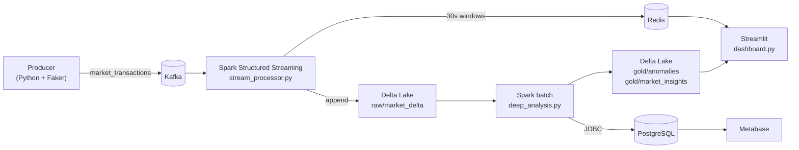

# Sentinela Mercado

Real-time anomaly detection for market transactions using a distributed streaming lakehouse.

A Python producer simulates e-commerce transactions into Kafka, Spark Structured Streaming lands them in Delta Lake and pushes live revenue to Redis, and a Spark batch job flags statistically abnormal prices. Results are served through a Streamlit dashboard (real-time) and Metabase (BI).

---

## Architecture



| Layer | What happens |
|---|---|
| **Bronze** | `apps/producer/main.py` sends ~2 transactions/s to the Kafka topic `market_transactions` |
| **Silver** | `apps/spark_streaming/stream_processor.py` parses events, writes them to Delta Lake partitioned by `year/month/day`, and aggregates revenue per category in 30-second windows, keeping the latest window of each category in Redis |
| **Gold** | `apps/batch_analysis/deep_analysis.py` computes per-category statistics and flags anomalies |
| **Serving** | Streamlit reads Redis (hot path) and the gold Delta tables (cold path); Metabase reads `gold_market_insights` from PostgreSQL |

---

## Stack

Python • PySpark 3.5 • Kafka (KRaft) • Delta Lake 3.2 • Redis • PostgreSQL • Streamlit • Metabase • Docker Compose

---

## Anomaly detection

Each transaction is compared against the distribution of its own category using the Z-score:

$$Z = \frac{X - \mu_{category}}{\sigma_{category}}$$

Transactions with $Z > 2$ (price above mean + 2σ) are flagged as anomalies.

---

## Project structure

```
apps/
├── producer/           # Kafka producer (fake transactions)
├── spark_streaming/    # Streaming job: Kafka → Delta Lake + Redis
├── batch_analysis/     # Batch job: statistics + anomalies → Delta gold + PostgreSQL
├── maintenance/        # VACUUM + OPTIMIZE for Delta tables
├── api/                # (planned) API service layer
└── mapreduce/          # (planned) MapReduce batch module
dashboard.py            # Streamlit dashboard
docker-compose.yml      # Kafka, Spark, Redis, PostgreSQL, Metabase
data/                   # Delta Lake storage (created at runtime, git-ignored)
```

---

## Running

### Prerequisites

- Docker + Docker Compose
- Python 3.10+

### 1. Start the infrastructure

```bash
# Create the data dir first: Spark runs as uid 185 inside the container
# and needs write access to this bind mount.
mkdir -p data && chmod 777 data

docker compose up -d

# The streaming job writes to Redis, so the client must exist in the Spark image
docker exec -u root spark-master pip install redis
```

### 2. Start the producer

```bash
python -m venv .venv && source .venv/bin/activate
pip install -r requirements.txt

python apps/producer/main.py
```

### 3. Run the streaming job

In another terminal (keep it running while the producer sends data):

```bash
docker exec -it spark-master /opt/spark/bin/spark-submit \
  --conf spark.jars.ivy=/tmp/.ivy \
  --packages io.delta:delta-spark_2.12:3.2.0,org.apache.spark:spark-sql-kafka-0-10_2.12:3.5.0 \
  /opt/spark/apps/spark_streaming/stream_processor.py
```

> The stream reads from the `latest` offset, so only events produced after it starts are processed.
> Redis keys (`revenue:<category>`) hold the revenue of each category's most recent 30s window, tolerate events up to 1 minute late (watermark), and expire after 2 minutes without new events.

### 4. Run the batch analysis

Once some data has accumulated:

```bash
docker exec -it spark-master /opt/spark/bin/spark-submit \
  --conf spark.jars.ivy=/tmp/.ivy \
  --packages io.delta:delta-spark_2.12:3.2.0,org.postgresql:postgresql:42.6.0 \
  /opt/spark/apps/batch_analysis/deep_analysis.py
```

Run it again whenever you want to refresh the gold tables.

### 5. Open the dashboards

```bash
streamlit run dashboard.py
```

| Service | URL |
|---|---|
| Streamlit dashboard | http://localhost:8501 |
| Metabase | http://localhost:3000 |
| Spark master UI | http://localhost:8080 |

To use Metabase, add a PostgreSQL database with host `postgres`, port `5432`, database `market_data`, user/password `postgres`, then query the `gold_market_insights` table.

#### Dashboard configuration

| Variable | Default | Description |
|---|---|---|
| `REDIS_HOST` | `localhost` | Redis host |
| `REDIS_PORT` | `6379` | Redis port |
| `SENTINELA_DATA_DIR` | `./data` | Root of the Delta Lake storage |
| `SENTINELA_REFRESH_SECONDS` | `2` | Auto-refresh interval |

---

## Maintenance

Compacts small files and removes files that are no longer referenced by the Delta tables:

```bash
docker exec -it spark-master /opt/spark/bin/spark-submit \
  --conf spark.jars.ivy=/tmp/.ivy \
  --packages io.delta:delta-spark_2.12:3.2.0 \
  /opt/spark/apps/maintenance/vacuum_cleaner.py
```

> ⚠️ This runs `VACUUM` with **0 hours of retention**, which deletes the table history (time travel). Don't run it while the streaming job is active.

---

## Stopping

```bash
docker compose down        # stop containers, keep volumes
docker compose down -v     # also delete Kafka and PostgreSQL volumes
rm -rf data                # delete the Delta Lake storage
```

---

## Roadmap

- [ ] API service layer (`apps/api`)
- [ ] MapReduce batch module (`apps/mapreduce`)
- [ ] Export anomalies to PostgreSQL for Metabase
- [ ] Bake Python dependencies into a custom Spark image

---

## Results


